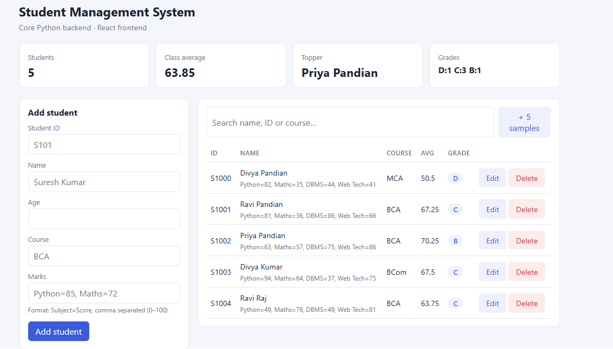
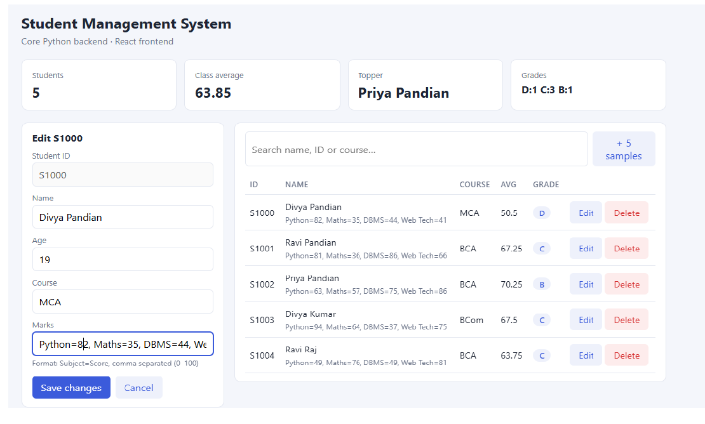
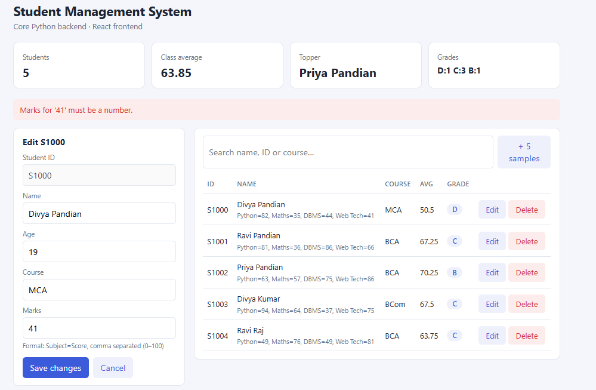
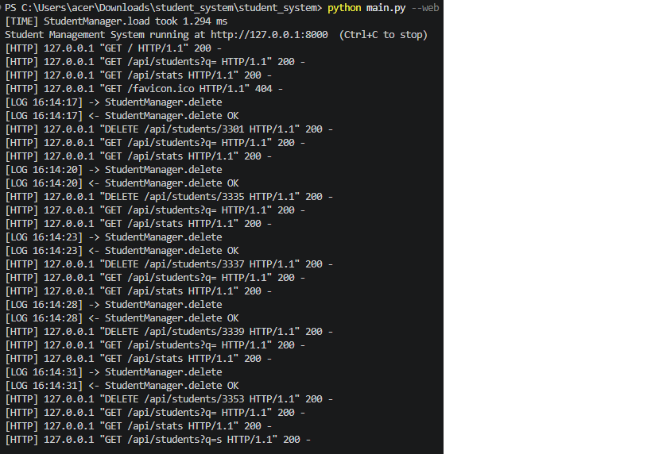

# Student Management System

A mini application built with **Core Python only** (standard library, no frameworks) with a simple **React** frontend. It manages student records: add, view, search, update, delete, and class statistics. Use it from the terminal or from the browser.

> Built to practise and demonstrate core Python concepts in one real project.

## Features

- Add, list, search, update and delete students
- Automatic total, average and grade calculation
- Class statistics: student count, class average, topper, grade distribution
- Data saved to a JSON file, so records survive restarts
- Input validation with clear error messages
- Generate sample students on demand
- Two interfaces: console menu and React web page

## Core Python concepts used

| Concept | Where | How it is used |
|---|---|---|
| Functions | `utils.py`, `cli.py` | Menu operations, validation, `calculate_average()`, `assign_grade()` |
| OOP | `models.py`, `manager.py` | `Student` and `StudentManager` classes, `@property`, `@classmethod` |
| Collections | `manager.py` | `dict` of `{student_id: Student}`, `list` for results, `Counter` for stats |
| Exceptions | `exceptions.py` | Custom exceptions plus `try/except` in the menu and API |
| File handling | `storage.py` | Save and load `students.json` (atomic write) |
| Decorators | `decorators.py` | `@log_call` (logging) and `@timed` (execution time) |
| Generators | `generators.py` | `generate_students()` yields students lazily with `yield` |
| Modules | all `.py` files | App split into focused modules joined with `import` |

## Project structure

```
student_system/
├── main.py            # entry point (console or --web)
├── cli.py             # console menu (functions)
├── utils.py           # validation and calculations (functions)
├── models.py          # Student class (OOP)
├── manager.py         # StudentManager class (OOP + collections)
├── exceptions.py      # custom exceptions
├── decorators.py      # logging and timing decorators
├── generators.py      # lazy student generator
├── storage.py         # JSON file save/load
├── server.py          # JSON API + static server (http.server)
└── static/
    └── index.html     # React frontend
```

## How it works

```
React page / Console menu
          │
          ▼
   StudentManager  ──►  Student (validation, average, grade)
          │
          ├──►  storage.py  ──►  students.json
          └──►  generators.py
```

The menu and the web server never touch the file or the calculations directly. They always go through `StudentManager`.

## Getting started

**Requirements:** Python 3.8 or newer. No packages to install.
The React page loads React from a CDN, so the browser needs internet access.

```bash
git clone https://github.com/Sureshkumar2k03/student-management-system.git
cd student-management-system
```

**Console version**

```bash
python main.py
```

**Web version**

```bash
python main.py --web
```

Then open <http://127.0.0.1:8000>. Use `--port 8001` if port 8000 is busy.

## API endpoints

| Method | Endpoint | Description |
|---|---|---|
| GET | `/api/students` | List all students (`?q=text` to search) |
| POST | `/api/students` | Add a student |
| PUT | `/api/students/<id>` | Update a student |
| DELETE | `/api/students/<id>` | Delete a student |
| GET | `/api/stats` | Class statistics |
| POST | `/api/seed?count=5` | Generate sample students |

Example request body for `POST /api/students`:

```json
{
  "student_id": "S101",
  "name": "Suresh Kumar",
  "age": 22,
  "course": "BCA",
  "marks": { "Python": 88, "Maths": 72 }
}
```

Errors return JSON such as `{"error": "..."}` with status 400 (invalid data), 404 (not found) or 409 (duplicate ID).

## Grading scale

| Average | Grade |
|---|---|
| 90+ | A+ |
| 80-89 | A |
| 70-79 | B |
| 60-69 | C |
| 50-59 | D |
| below 50 | F |

## Console demo

```
===== Student Management System =====
1. Add student      2. List all       3. Search
4. Update           5. Delete         6. Statistics
7. Generate sample students           0. Exit

Choose: 6
  Students: 4  Class average: 67.38
  Topper: Suresh (85.0)
```

## Screenshots

### Dashboard


### Edit student


### Validation (custom exceptions)


### Console version


## Possible improvements

- Export records to CSV
- "Top students" view using the existing generator filter
- Unit tests with `unittest`
- Pagination for large datasets

## Author

**Suresh Kumar**: BCA graduate, Python Full Stack developer in progress.
